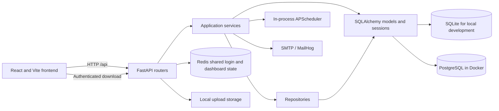
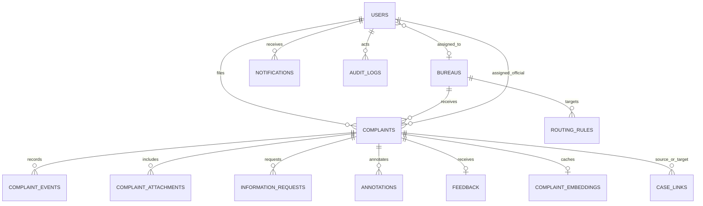
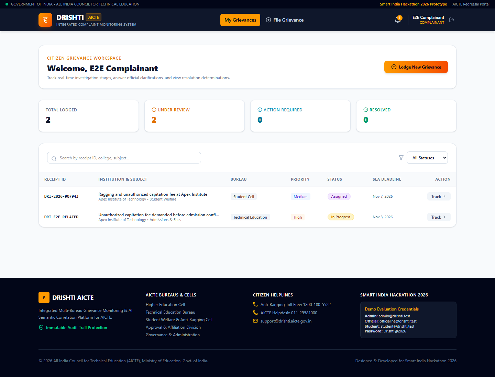
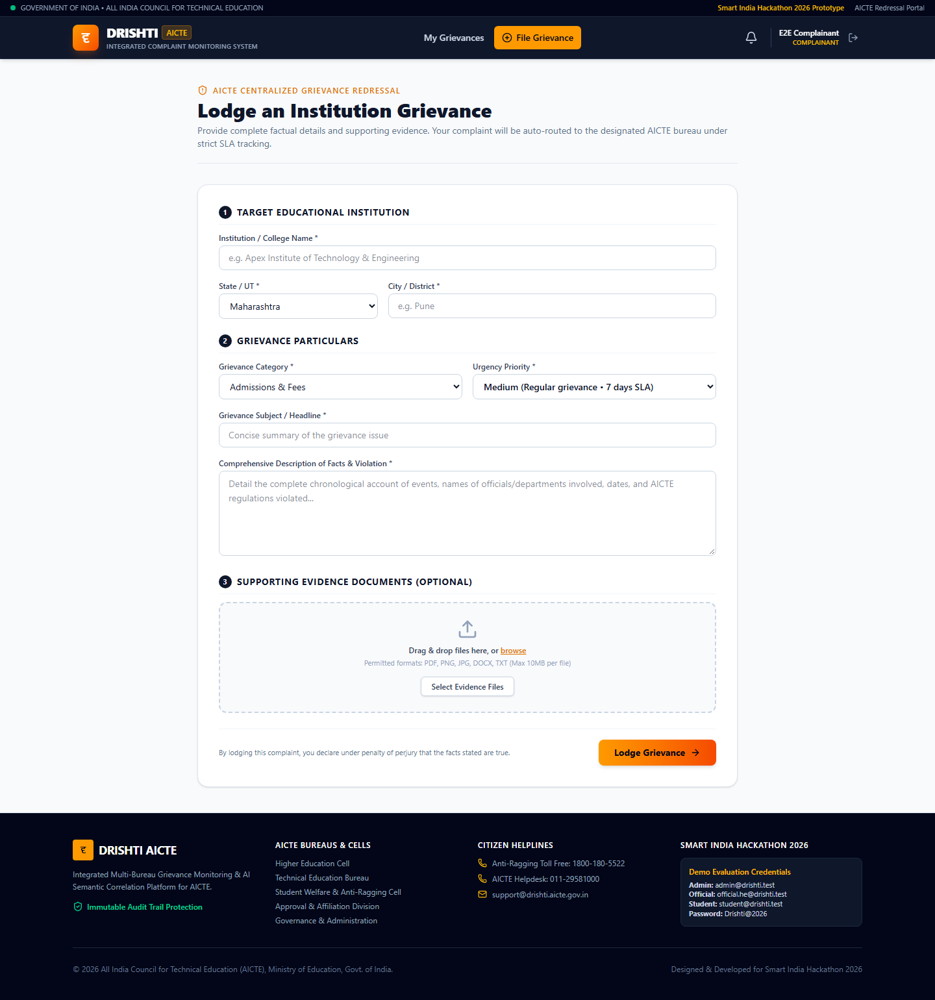
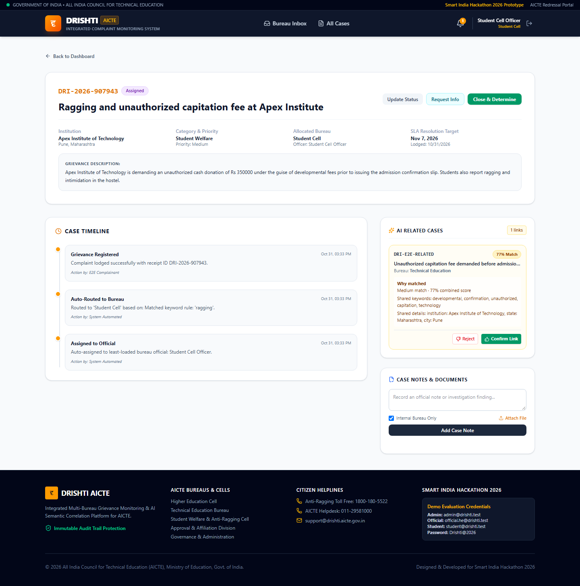
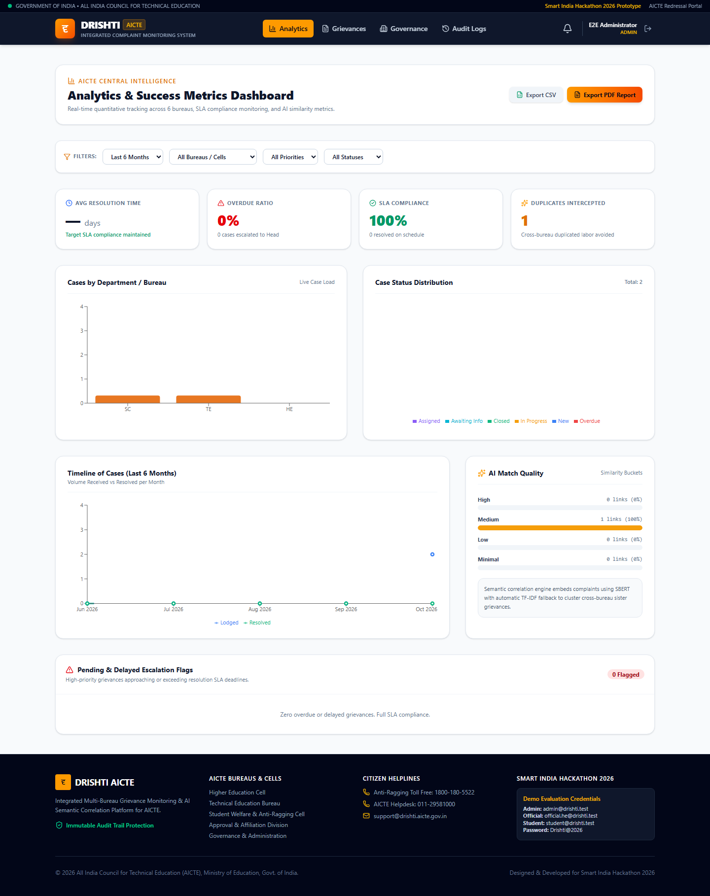
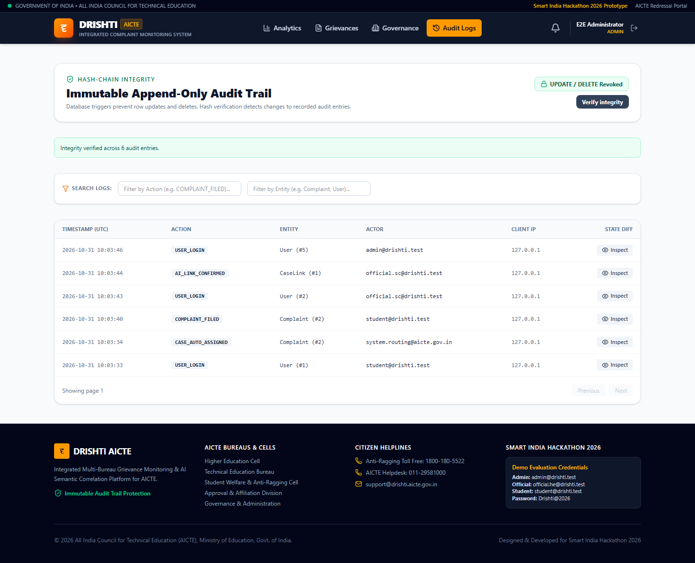

# Drishti AICTE

Drishti is a Smart India Hackathon prototype for receiving, routing, tracking,
and reviewing institution-related complaints across AICTE bureaus and cells.
It includes a React web interface and a FastAPI backend. The current repository
is a prototype and is not ready for production deployment.

## Architecture

### Components



Routers handle HTTP concerns and delegate application behavior to services.
Reusable data access is in repositories; services own workflow orchestration
and transactions. Some existing services still issue SQLAlchemy operations
directly, so the repository boundary is not yet universal.

### Data model



`CASE_LINKS` has two complaint references (source and target). Confirmed links
are also joined into explicit case groups.

## Technology

- Frontend: React 19, Vite, Tailwind CSS 4, React Router, Recharts, Axios
- Backend: Python 3.11 in Docker, FastAPI, SQLAlchemy 2, Pydantic 2, Alembic
- Authentication: short-lived JWT access tokens via PyJWT, rotated server-tracked
  refresh tokens in an httpOnly cookie; passwords are hashed with bcrypt
- Data: SQLite for local development; PostgreSQL 16 in Docker Compose
- Background work: in-process APScheduler for SLA checks
- Shared state: Redis-backed login lockout and dashboard cache, with a
  process-local fallback for development without Redis
- Similarity: configurable TF-IDF/sentence-embedding hybrid with multilingual
  model selection, cached embeddings, and logged TF-IDF-only fallback
- Tests: pytest and httpx

## Getting started

### Docker

Docker Compose starts PostgreSQL, Redis, MailHog, the backend, and the frontend:

```powershell
docker compose up --build
```

The backend runs `alembic upgrade head` before seeding prototype data. On
existing databases previously created with SQLAlchemy `create_all`, the initial
migration creates any newly modelled tables without dropping existing data.
The backend image downloads the multilingual sentence model during its build
and keeps it in the image's Hugging Face cache. Local evaluation downloads the
same model on first use and reuses the Hugging Face cache on subsequent runs.

| Service | URL |
|---|---|
| Web application | <http://localhost:80> |
| Backend API | <http://localhost:8000> |
| API documentation | <http://localhost:8000/docs> |
| MailHog | <http://localhost:8025> |

### Local development

Use Python 3.11 for the documented backend environment. From the repository
root, create and activate a virtual environment, install dependencies, apply
migrations, seed a local SQLite database, and start the API:

```powershell
py -3.11 -m venv .venv
.\.venv\Scripts\Activate.ps1
python -m pip install -r requirements.txt
alembic upgrade head
python -m app.seed
uvicorn app.main:app --reload --host 127.0.0.1 --port 8000
```

In another terminal:

```powershell
Set-Location frontend
npm install
npm run dev
```

The frontend is available at <http://localhost:5173>. Configure local settings
through environment variables or a local `.env` file; never use prototype
defaults for a deployed environment. The backend uses `REDIS_URL` for shared
login-lockout and dashboard-cache state. When Redis is not reachable in
development, it falls back to process-local memory; production requests that
need shared state return an explicit service-unavailable error instead.

## Demo accounts

The seed script creates synthetic prototype accounts. These credentials are for
local demonstrations only:

| Role | Email | Password |
|---|---|---|
| Admin | `admin@drishti.test` | `Drishti@2026` |
| Official | `official.he@drishti.test` | `Drishti@2026` |
| Complainant | `student@drishti.test` | `Drishti@2026` |

## Current features

- Account registration, login, and role-based route restrictions
- Complaint submission with a generated receipt ID, bureau routing rules, and
  least-loaded-official assignment when an eligible official exists
- Complaint list filtering and offset pagination
- File uploads with random server-side names, size/signature/extension checks,
  and authenticated complaint-scoped downloads
- In-app notifications and SMTP email attempts
- Complaint timelines, information requests and responses, annotations,
  determinations, state-validated closure, and post-closure feedback
- Confirmed related cases are joined in explicit case groups
- Hybrid similarity suggestions with match score/bucket, shared keywords and
  shared metadata explanations, and official confirm/reject decisions
- Admin-configurable similarity bucket thresholds
- SLA deadline calculation and an in-process overdue-case scheduler
- Database triggers that block updates and deletes to audit-log rows on
  supported SQLite and PostgreSQL deployments, with a SHA-256 hash chain and
  admin verification endpoint
- Admin user, bureau, routing-rule, and SLA configuration operations
- Analytics with a short-TTL shared dashboard aggregate cache, CSV/PDF report
  routes, and JSON health/metrics endpoints

These features have important limitations: some services still access
SQLAlchemy directly instead of through repositories; the in-memory fallback
for login lockout and dashboard cache is process-local when Redis is unavailable
in development; and local performance smoke tests are not production capacity
estimates. The
84-pair synthetic evaluation includes TF-IDF, multilingual sentence-embedding,
and hybrid measurements; it is not a production accuracy estimate. See
[docs/AUDIT.md](./docs/AUDIT.md), [docs/PERFORMANCE.md](./docs/PERFORMANCE.md),
and [ml/results.md](./ml/results.md) for current audit status, measured load
results, and ML metrics.

To run the labelled ML evaluation locally (the first run downloads and caches
the embedding model):

```powershell
.\.venv\Scripts\python.exe ml\evaluate.py
```

## Screenshots

These are real screenshots captured from the running local app with synthetic
demo data; they are illustrative, not production evidence.











## API overview

The API is versioned under `/api/v1`. Interactive documentation is served at
`/docs`.

| Area | Routes |
|---|---|
| Authentication | `/auth/register`, `/auth/login`, `/auth/refresh`, `/auth/me` |
| Complaints | `/complaints/`, `/complaints/check-duplicates`, `/complaints/{id}` |
| Complaint follow-up | `/complaints/{id}/info-respond`, `/complaints/{id}/feedback` |
| Official operations | `/officials/cases/{id}/status`, `/request-info`, `/annotate`, `/determination` |
| Admin | `/admin/users`, `/admin/bureaus`, `/admin/rules`, `/admin/sla`, `/admin/similarity-thresholds`, `/admin/audit-logs`, `/admin/audit-logs/verify` |
| Analytics and reports | `/analytics/dashboard`, `/reports/export/csv`, `/reports/export/pdf` |
| Notifications | `/notifications/`, `/notifications/{id}/read` |

The report routes may be further restricted by role. See the OpenAPI
documentation for request and response schemas.

## Testing and build checks

From the repository root:

```powershell
.\.venv\Scripts\Activate.ps1
pytest tests/ -v
```

Frontend checks:

```powershell
Set-Location frontend
npm run lint
npm run build
npm audit --audit-level=high
```

The GitHub Actions workflow runs the backend pytest suite and pip-audit, plus
frontend lint, production build, and npm audit. The pytest suite includes
role-denial, object-authorization, refresh-token, upload-validation,
security-header, audit-integrity, and workflow tests. There is no automated
browser end-to-end suite. The Locust report in
[docs/PERFORMANCE.md](./docs/PERFORMANCE.md) is a measured local load-test
smoke test, not production capacity validation. The synthetic ML evaluation measures TF-IDF, sentence-embedding, and hybrid
metrics from the labelled CSV; see [ml/results.md](./ml/results.md).

## Security notes

This repository remains a prototype and is not ready for production deployment.
Do not use demo accounts or checked-in Compose database credentials in a
deployed environment. Production startup rejects the prototype signing key;
supply a unique `SECRET_KEY`, `APP_ENV=production`, database credentials, and
an explicit `BACKEND_CORS_ORIGINS` value through protected environment
configuration. Refresh tokens are stored in an httpOnly cookie and rotated
server-side; uploaded files are served only through authenticated,
complaint-authorized endpoints. Login lockout currently uses process memory
and is not shared across multiple workers or restarts.
