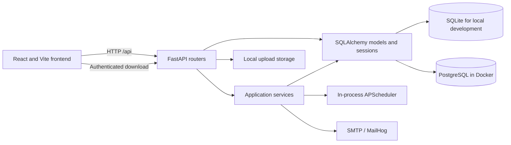
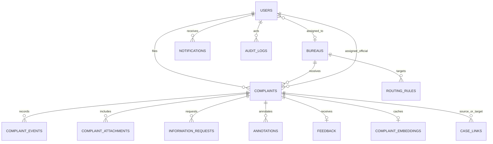

# Drishti AICTE

Drishti is a Smart India Hackathon prototype for receiving, routing, tracking,
and reviewing institution-related complaints across AICTE bureaus and cells.
It includes a React web interface and a FastAPI backend. The current repository
is a prototype and is not ready for production deployment.

## Architecture

### Components



The routers currently contain some workflow and database logic; the diagram
shows the major components, not a fully enforced layered architecture.

### Data model



`CASE_LINKS` has two complaint references (source and target). The current
implementation has no explicit case-group entity.

## Technology

- Frontend: React 19, Vite, Tailwind CSS 4, React Router, Recharts, Axios
- Backend: Python 3.11 in Docker, FastAPI, SQLAlchemy 2, Pydantic 2, Alembic
- Authentication: short-lived JWT access tokens via PyJWT, rotated server-tracked
  refresh tokens in an httpOnly cookie; passwords are hashed with bcrypt
- Data: SQLite for local development; PostgreSQL 16 in Docker Compose
- Background work: in-process APScheduler for SLA checks
- Similarity: scikit-learn TF-IDF fallback and optional sentence-transformers
- Tests: pytest and httpx

## Getting started

### Docker

Docker Compose starts PostgreSQL, MailHog, the backend, and the frontend:

```powershell
docker compose up --build
```

The backend seeds prototype data when it starts. Database schema creation and
migrations are still being improved; use only disposable data for development.

| Service | URL |
|---|---|
| Web application | <http://localhost:80> |
| Backend API | <http://localhost:8000> |
| API documentation | <http://localhost:8000/docs> |
| MailHog | <http://localhost:8025> |

### Local development

Use Python 3.11 for the documented backend environment. From the repository
root, create and activate a virtual environment, install dependencies, seed a
local SQLite database, and start the API:

```powershell
py -3.11 -m venv .venv
.\.venv\Scripts\Activate.ps1
python -m pip install -r requirements.txt
python -m app.seed
uvicorn app.main:app --reload --host 127.0.0.1 --port 8000
```

In another terminal:

```powershell
Set-Location frontend
npm install
npm run dev
```

The frontend is available at <http://localhost:5173>. Configure local settings
through environment variables or a local `.env` file; never use prototype
defaults for a deployed environment.

## Demo accounts

The seed script creates synthetic prototype accounts. These credentials are for
local demonstrations only:

| Role | Email | Password |
|---|---|---|
| Admin | `admin@drishti.test` | `Drishti@2026` |
| Official | `official.he@drishti.test` | `Drishti@2026` |
| Complainant | `student@drishti.test` | `Drishti@2026` |

## Current features

- Account registration, login, and role-based route restrictions
- Complaint submission with a generated receipt ID, bureau routing rules, and
  least-loaded-official assignment when an eligible official exists
- Complaint list filtering and offset pagination
- File uploads with random server-side names, size/signature/extension checks,
  and authenticated complaint-scoped downloads
- In-app notifications and SMTP email attempts
- Complaint timelines, information requests and responses, annotations,
  determinations, closure, and post-closure feedback
- Similarity suggestions, a basic shared-keyword explanation, and official
  confirm/reject decisions
- SLA deadline calculation and an in-process overdue-case scheduler
- Database triggers that block updates and deletes to audit-log rows on
  supported SQLite and PostgreSQL deployments, with a SHA-256 hash chain and
  admin verification endpoint
- Admin user, bureau, routing-rule, and SLA configuration operations
- Analytics, CSV/PDF report routes, and JSON health/metrics endpoints

These features have important limitations: workflow transitions are not yet
validated by a state machine; similarity does not use a hybrid score; login
lockout state is in-process; and production deployment, migrations, and
performance still need further hardening. See [docs/AUDIT.md](./docs/AUDIT.md).

## API overview

The API is versioned under `/api/v1`. Interactive documentation is served at
`/docs`.

| Area | Routes |
|---|---|
| Authentication | `/auth/register`, `/auth/login`, `/auth/refresh`, `/auth/me` |
| Complaints | `/complaints/`, `/complaints/check-duplicates`, `/complaints/{id}` |
| Complaint follow-up | `/complaints/{id}/info-respond`, `/complaints/{id}/feedback` |
| Official operations | `/officials/cases/{id}/status`, `/request-info`, `/annotate`, `/determination` |
| Admin | `/admin/users`, `/admin/bureaus`, `/admin/rules`, `/admin/sla`, `/admin/audit-logs` |
| Analytics and reports | `/analytics/dashboard`, `/reports/export/csv`, `/reports/export/pdf` |
| Notifications | `/notifications/`, `/notifications/{id}/read` |

The report routes may be further restricted by role. See the OpenAPI
documentation for request and response schemas.

## Testing and build checks

From the repository root:

```powershell
.\.venv\Scripts\Activate.ps1
pytest tests/ -v
```

Frontend checks:

```powershell
Set-Location frontend
npm run lint
npm run build
```

The pytest suite includes role-denial, object-authorization, refresh-token,
upload-validation, security-header, and audit-integrity tests, but does not yet
provide complete workflow, browser, or performance coverage. ML evaluation
still requires the Phase C correction before any reported model metrics should
be treated as measured performance.

## Security notes

This repository remains a prototype and is not ready for production deployment.
Do not use demo accounts or checked-in Compose database credentials in a
deployed environment. Production startup rejects the prototype signing key;
supply a unique `SECRET_KEY`, `APP_ENV=production`, database credentials, and
an explicit `BACKEND_CORS_ORIGINS` value through protected environment
configuration. Refresh tokens are stored in an httpOnly cookie and rotated
server-side; uploaded files are served only through authenticated,
complaint-authorized endpoints. Login lockout currently uses process memory
and is not shared across multiple workers or restarts.

## Screenshots

No screenshots are currently checked into the repository. Do not interpret
this section as evidence of a complete or production-ready interface.
