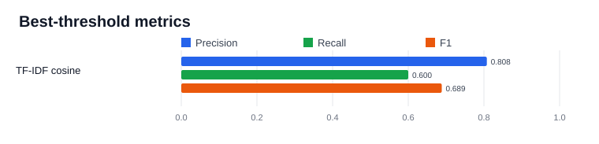

# Similarity Evaluation Results

- Generated: 2026-10-31T16:14:31+00:00
- Dataset: `ml/dataset.csv` (84 synthetic labelled complaint pairs)
- Labels: 35 related, 49 unrelated
- Language labels: English: 65, Hindi: 9, Hindi-English: 5, Hinglish: 5
- Scores and metrics below are computed from the labelled CSV; no metrics are simulated.

This small synthetic dataset is a smoke-test benchmark, not an estimate of production accuracy. Thresholds were evaluated against the supplied labels.

## Hybrid weight selection

Selected **0.65 TF-IDF / 0.35 embedding** after evaluating all weight pairs in 0.05 increments from 0.00/1.00 through 1.00/0.00. At each pair, the best threshold was chosen by F1; weight pairs were ranked by F1, precision, recall, then TF-IDF weight. The selected in-sample result is F1 0.9143 at threshold 0.15. This is exploratory tuning and not independent validation.



## Model availability

Loaded `paraphrase-multilingual-MiniLM-L12-v2` and computed embeddings from the dataset.

## TF-IDF cosine

Best F1 threshold (searched in 0.05 increments): **0.05**

| Threshold | Precision | Recall | F1 | Accuracy | TP | FP | TN | FN |
|---:|---:|---:|---:|---:|---:|---:|---:|---:|
| 0.05 (best F1) | 0.8077 | 0.6000 | 0.6885 | 0.7738 | 21 | 5 | 44 | 14 |
| 0.30 | 0.0000 | 0.0000 | 0.0000 | 0.5833 | 0 | 0 | 49 | 35 |
| 0.50 | 0.0000 | 0.0000 | 0.0000 | 0.5833 | 0 | 0 | 49 | 35 |
| 0.80 | 0.0000 | 0.0000 | 0.0000 | 0.5833 | 0 | 0 | 49 | 35 |

Confusion matrix at the best-F1 threshold (0.05):

```text
                  Predicted unrelated  Predicted related
Actual unrelated                44                  5
Actual related                  14                 21
```

## Sentence embeddings (paraphrase-multilingual-MiniLM-L12-v2)

Best F1 threshold (searched in 0.05 increments): **0.30**

| Threshold | Precision | Recall | F1 | Accuracy | TP | FP | TN | FN |
|---:|---:|---:|---:|---:|---:|---:|---:|---:|
| 0.30 (best F1) | 0.8095 | 0.9714 | 0.8831 | 0.8929 | 34 | 8 | 41 | 1 |
| 0.50 | 0.9259 | 0.7143 | 0.8065 | 0.8571 | 25 | 2 | 47 | 10 |
| 0.80 | 0.0000 | 0.0000 | 0.0000 | 0.5833 | 0 | 0 | 49 | 35 |

Confusion matrix at the best-F1 threshold (0.30):

```text
                  Predicted unrelated  Predicted related
Actual unrelated                41                  8
Actual related                   1                 34
```

## Hybrid weighted cosine

Best F1 threshold (searched in 0.05 increments): **0.15**

| Threshold | Precision | Recall | F1 | Accuracy | TP | FP | TN | FN |
|---:|---:|---:|---:|---:|---:|---:|---:|---:|
| 0.15 (best F1) | 0.9143 | 0.9143 | 0.9143 | 0.9286 | 32 | 3 | 46 | 3 |
| 0.30 | 1.0000 | 0.1714 | 0.2927 | 0.6548 | 6 | 0 | 49 | 29 |
| 0.50 | 0.0000 | 0.0000 | 0.0000 | 0.5833 | 0 | 0 | 49 | 35 |
| 0.80 | 0.0000 | 0.0000 | 0.0000 | 0.5833 | 0 | 0 | 49 | 35 |

Confusion matrix at the best-F1 threshold (0.15):

```text
                  Predicted unrelated  Predicted related
Actual unrelated                46                  3
Actual related                   3                 32
```
